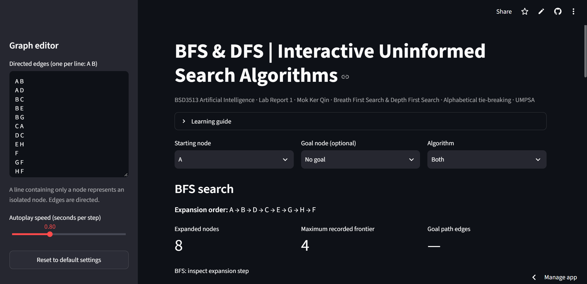
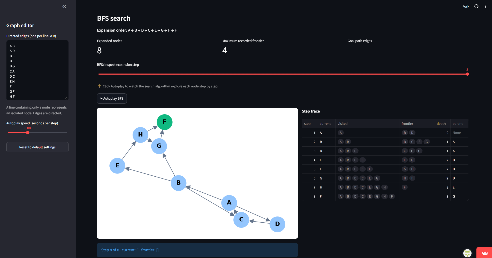
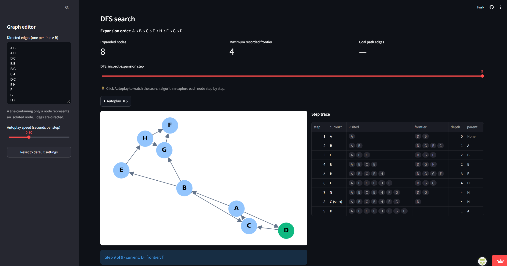
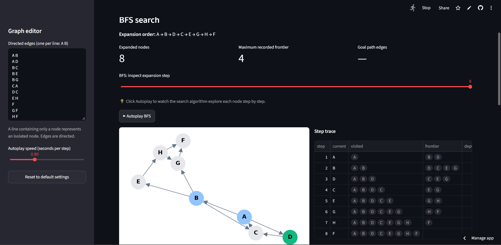
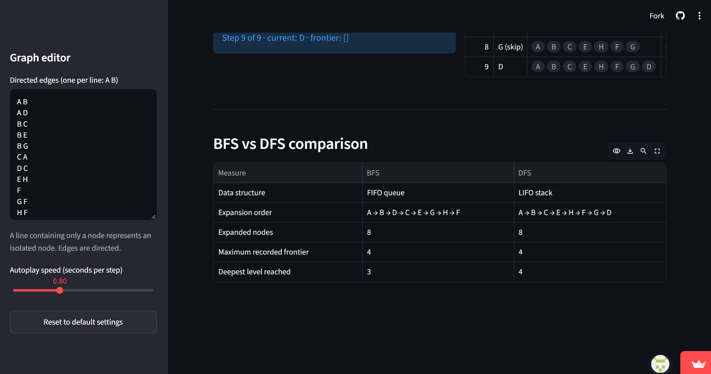

# BFS & DFS | Interactive Uninformed Search

[](https://ailabreport1.streamlit.app)
[](https://github.com/mokkerqin-hub/AI_LabReport1/actions/workflows/tests.yml)

BSD3513 Introduction to Artificial Intelligence — Lab Report 1 · Mok Ker Qin · UMPSA

A Streamlit app that runs Breadth-First Search (BFS) and Depth-First Search (DFS) on a directed graph with alphabetical tie-breaking.

**Live app:** https://ailabreport1.streamlit.app



## Features
- Editable directed graph (Lab 1 graph by default)
- BFS and DFS step-by-step trace with graph visualisation
- Autoplay animation with adjustable speed
- BFS vs DFS comparison table
- Reset to default settings

| BFS search | DFS search |
|---|---|
|  |  |

| Autoplay (BFS in progress) | BFS vs DFS comparison |
|---|---|
|  |  |

## Run locally
```bash
git clone https://github.com/mokkerqin-hub/AI_LabReport1.git
cd AI_LabReport1
pip install -r requirements.txt
streamlit run bfsdfs.py
```

Run the tests with `pip install pytest` then `python -m pytest -q`.

## Project structure
```
bfsdfs.py            # Streamlit app
requirements.txt     # dependencies
tests/               # pytest unit tests
screenshots/         # README images
```

## Version
**v1.0** — BFS/DFS trace, autoplay, comparison table, reset button.
